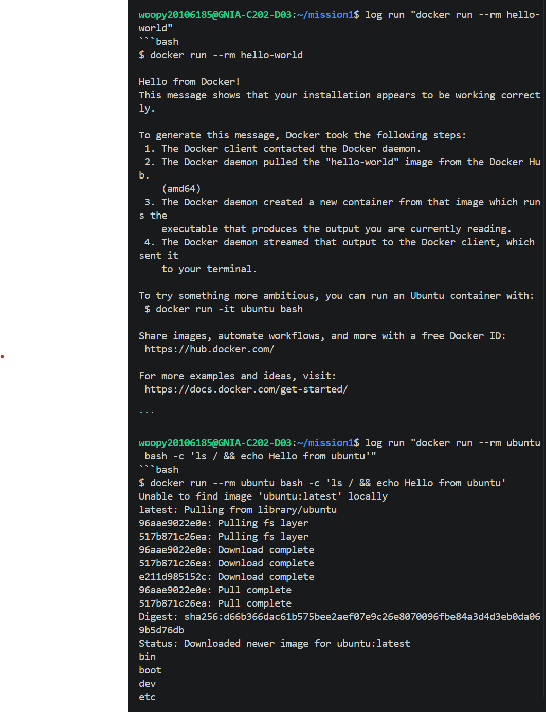
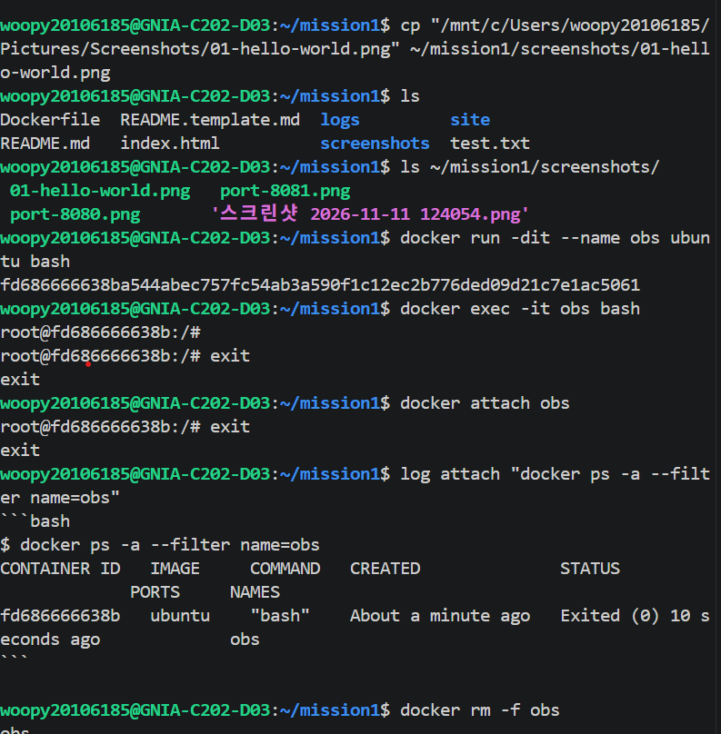
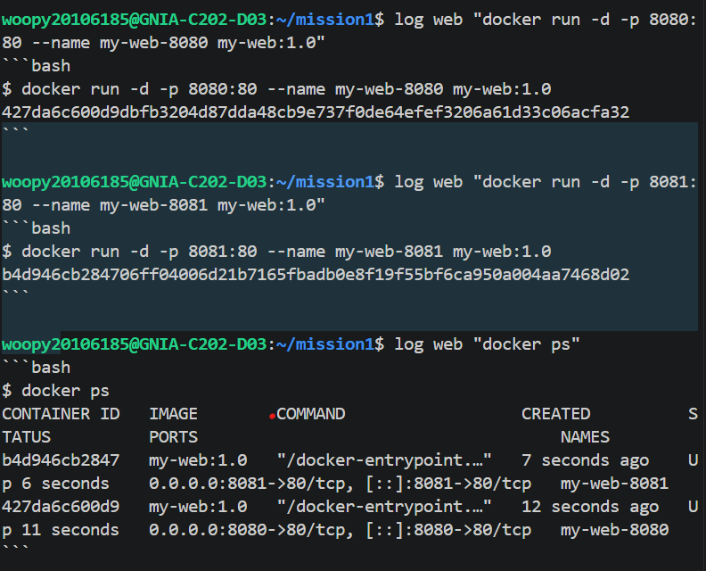
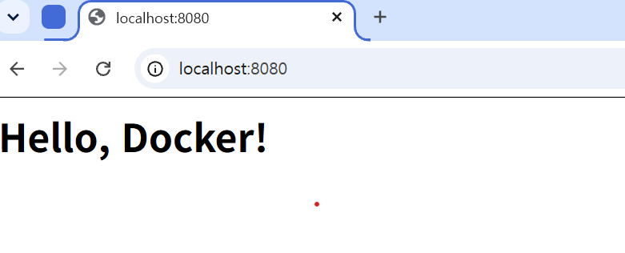
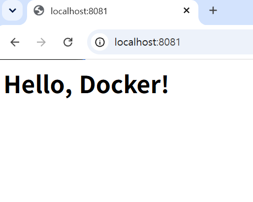
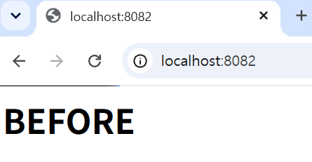
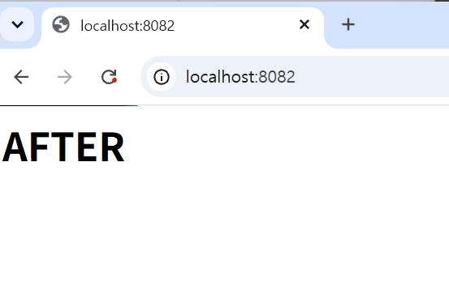

# Mission 1 - 내 컴퓨터에 개발자용 '작업실' 꾸미기

터미널(Linux CLI), Docker, Git/GitHub로 개발 워크스테이션을 직접 세팅하고, 모든 수행 과정을 실행 로그와 증거로 기록한 기술 문서입니다.

---

## 1. 프로젝트 개요

- **미션 목표**: 터미널로 작업 디렉토리·권한을 정리하고, Docker를 점검한 뒤 컨테이너를 실행/관리한다. Dockerfile로 웹 서버 이미지를 만들고 포트 매핑·바인드 마운트·볼륨을 직접 검증한다. 마지막으로 Git 설정과 GitHub/VSCode 연동을 완료한다.
- **핵심 관점**: 같은 서비스를 여러 번 실행해도 재현되는 환경 만들기 (이미지와 컨테이너의 분리, 격리된 실행 환경, 포트·스토리지 연결)
- **제출 저장소**: https://github.com/kungfupanda1017/mission1

---

## 2. 실행 환경

| 항목 | 내용 |
|---|---|
| OS | Windows + Ubuntu (WSL2) |
| Shell | bash |
| 터미널 | Windows Terminal / VSCode 통합 터미널 (WSL) |
| Docker | 아래 로그 참고 |
| Git | 아래 로그 참고 |

```bash
$ cat /etc/os-release | head -2
PRETTY_NAME="Ubuntu 26.04.1 LTS"
NAME="Ubuntu"
```

```bash
$ echo $SHELL; bash --version | head -1
/bin/bash
GNU bash, version 5.3.9(1)-release (x86_64-pc-linux-gnu)
```

```bash
$ uname -r
6.18.58.1-microsoft-standard-WSL2
```

```bash
$ docker --version
Docker version 29.9.3, build 5457199
```

```bash
$ git --version
git version 2.53.0
```

---

## 3. 수행 항목 체크리스트

| 항목 | 완료 | 위치 |
|---|:---:|---|
| 터미널 기본 조작 (위치·목록·이동·생성·복사·이름변경·삭제·내용확인) | ✅ | [5장](#5-터미널-조작-로그) |
| 권한 실습 (파일 1개, 디렉토리 1개 전/후 비교) | ✅ | [6장](#6-권한-실습) |
| Docker 설치/점검 (`--version`, `info`) | ✅ | [7장](#7-docker-설치-및-기본-점검) |
| Docker 기본 운영 (images, ps, logs, stats) | ✅ | [8장](#8-docker-기본-운영-명령) |
| 컨테이너 실행 (hello-world, ubuntu, attach/exec) | ✅ | [9장](#9-컨테이너-실행-실습) |
| 기존 베이스 기반 커스텀 이미지 (NGINX) | ✅ | [10장](#10-커스텀-이미지-제작) |
| 포트 매핑 접속 (2회) | ✅ | [11장](#11-포트-매핑-실습) |
| 바인드 마운트 반영 | ✅ | [12장](#12-바인드-마운트-실습) |
| Docker 볼륨 영속성 | ✅ | [13장](#13-docker-볼륨-영속성-검증) |
| Git 설정 + GitHub/VSCode 연동 | ✅ | [14장](#14-git-설정-및-githubvscode-연동) |
| 트러블슈팅 2건 이상 | ✅ | [15장](#15-트러블슈팅) |

---

## 4. 저장소 구조

```text
mission1/
├── README.md          # 기술 문서 (본 문서)
├── Dockerfile         # nginx:alpine 기반 커스텀 이미지
├── index.html         # 컨테이너에 넣는 웹 페이지
├── site/              # 바인드 마운트 실습용 폴더
├── logs/              # 실제 실행 로그 원본
└── screenshots/       # 증빙 스크린샷
```

---

## 5. 터미널 조작 로그

현재 위치 확인 → 숨김 파일 포함 목록 → 디렉토리 이동/생성 → 파일 생성/복사/이동(이름변경) → 내용 확인 → 삭제 순서로 수행했습니다.

<!-- LOG:term -->

---

## 6. 권한 실습

### 권한 읽는 법

권한은 **소유자 / 그룹 / 기타** 3자리이며, 각 자리는 읽기(r=4) + 쓰기(w=2) + 실행(x=1)의 합입니다.

| 숫자 | 계산 | 기호 | 의미 |
|:---:|---|:---:|---|
| 7 | 4+2+1 | rwx | 읽기·쓰기·실행 |
| 6 | 4+2 | rw- | 읽기·쓰기 |
| 5 | 4+1 | r-x | 읽기·실행 |
| 4 | 4 | r-- | 읽기만 |
| 0 | 0 | --- | 권한 없음 |

- `644` = `rw-r--r--` → 소유자는 읽기/쓰기, 그룹·기타는 읽기만 (일반 파일의 기본값)
- `755` = `rwxr-xr-x` → 소유자는 전체 권한, 그룹·기타는 읽기/실행 (실행 파일·디렉토리의 기본값)
- `700` = `rwx------` → 소유자만 접근 가능
- 디렉토리의 `x`는 "그 디렉토리 안으로 들어갈 수 있는 권한"입니다.

### 변경 전/후 비교 (파일 1개, 디렉토리 1개)

<!-- LOG:perm -->

---

## 7. Docker 설치 및 기본 점검

`docker --version`으로 설치를, `docker info`로 데몬(Server) 동작을 확인했습니다.

```bash
$ docker --version
Docker version 29.9.3, build 5457199
```

```bash
$ docker info | head -25
Client: Docker Engine - Community
 Version:    29.9.3
 Context:    default
 Debug Mode: false
 Plugins:
  buildx: Docker Buildx (Docker Inc.)
    Version:  v0.38.1
    Path:     /usr/libexec/docker/cli-plugins/docker-buildx
  compose: Docker Compose (Docker Inc.)
    Version:  v5.7.0
    Path:     /usr/libexec/docker/cli-plugins/docker-compose

Server:
 Containers: 1
  Running: 0
  Paused: 0
  Stopped: 1
 Images: 2
 Server Version: 29.9.3
 Storage Driver: overlayfs
  driver-type: io.containerd.snapshotter.v1
 Logging Driver: json-file
 Cgroup Driver: systemd
 Cgroup Version: 2
 Plugins:
```

---

## 8. Docker 기본 운영 명령

이미지 다운로드/목록, 컨테이너 실행/중지/재시작/목록, 로그, 리소스 확인을 수행했습니다.

```bash
$ docker pull nginx:alpine
alpine: Pulling from library/nginx
c4f3d97811f6: Pulling fs layer
881fc932939e: Pulling fs layer
77a3bfea78f5: Pulling fs layer
61d8f4c85a74: Pulling fs layer
04c3905a997c: Pulling fs layer
1dc588c89da1: Pulling fs layer
7cb374baf968: Pulling fs layer
4c8c172c6586: Pulling fs layer
881fc932939e: Download complete
1dc588c89da1: Download complete
4c8c172c6586: Download complete
04c3905a997c: Download complete
7cb374baf968: Download complete
77a3bfea78f5: Download complete
61d8f4c85a74: Download complete
c4f3d97811f6: Download complete
881fc932939e: Pull complete
04c3905a997c: Pull complete
77a3bfea78f5: Pull complete
1dc588c89da1: Pull complete
4c8c172c6586: Pull complete
7cb374baf968: Pull complete
61d8f4c85a74: Pull complete
79979b969278: Download complete
33247e384332: Download complete
c4f3d97811f6: Pull complete
Digest: sha256:fb4658584bd9a916ffb6f6e365f97c25cfdb2923801f551ea08356e695f14ff7
Status: Downloaded newer image for nginx:alpine
docker.io/library/nginx:alpine
```

```bash
$ docker images
IMAGE                ID             DISK USAGE   CONTENT SIZE   EXTRA
hello-world:latest   c567b231f656       25.9kB         9.49kB   U    
nginx:alpine         fb4658584bd9       94.5MB         27.2MB        
nginx:latest         5ab5b0b01097        243MB         66.8MB        
```

```bash
$ docker run -d --name ops-test nginx:alpine
40afcd320391226e66189021a96cefb7fa9fdc6427c8f02e21cc860de673c979
```

```bash
$ docker ps
CONTAINER ID   IMAGE          COMMAND                  CREATED         STATUS         PORTS     NAMES
40afcd320391   nginx:alpine   "/docker-entrypoint.…"   4 seconds ago   Up 4 seconds   80/tcp    ops-test
```

```bash
$ docker logs ops-test
/docker-entrypoint.sh: /docker-entrypoint.d/ is not empty, will attempt to perform configuration
/docker-entrypoint.sh: Looking for shell scripts in /docker-entrypoint.d/
/docker-entrypoint.sh: Launching /docker-entrypoint.d/10-listen-on-ipv6-by-default.sh
10-listen-on-ipv6-by-default.sh: info: Getting the checksum of /etc/nginx/conf.d/default.conf
10-listen-on-ipv6-by-default.sh: info: Enabled listen on IPv6 in /etc/nginx/conf.d/default.conf
/docker-entrypoint.sh: Sourcing /docker-entrypoint.d/15-local-resolvers.envsh
/docker-entrypoint.sh: Launching /docker-entrypoint.d/20-envsubst-on-templates.sh
/docker-entrypoint.sh: Launching /docker-entrypoint.d/30-tune-worker-processes.sh
/docker-entrypoint.sh: Configuration complete; ready for start up
2026/11/23 04:52:57 [notice] 1#1: using the "epoll" event method
2026/11/23 04:52:57 [notice] 1#1: nginx/1.31.9
2026/11/23 04:52:57 [notice] 1#1: built by gcc 15.2.0 (Alpine 15.2.0) 
2026/11/23 04:52:57 [notice] 1#1: OS: Linux 6.18.58.1-microsoft-standard-WSL2
2026/11/23 04:52:57 [notice] 1#1: getrlimit(RLIMIT_NOFILE): 1024:1048576
2026/11/23 04:52:57 [notice] 1#1: start worker processes
2026/11/23 04:52:57 [notice] 1#1: start worker process 30
2026/11/23 04:52:57 [notice] 1#1: start worker process 31
2026/11/23 04:52:57 [notice] 1#1: start worker process 32
2026/11/23 04:52:57 [notice] 1#1: start worker process 33
2026/11/23 04:52:57 [notice] 1#1: start worker process 34
2026/11/23 04:52:57 [notice] 1#1: start worker process 35
2026/11/23 04:52:57 [notice] 1#1: start worker process 36
2026/11/23 04:52:57 [notice] 1#1: start worker process 37
2026/11/23 04:52:57 [notice] 1#1: start worker process 38
2026/11/23 04:52:57 [notice] 1#1: start worker process 39
2026/11/23 04:52:57 [notice] 1#1: start worker process 40
2026/11/23 04:52:57 [notice] 1#1: start worker process 41
2026/11/23 04:52:57 [notice] 1#1: start worker process 42
2026/11/23 04:52:57 [notice] 1#1: start worker process 43
2026/11/23 04:52:57 [notice] 1#1: start worker process 44
2026/11/23 04:52:57 [notice] 1#1: start worker process 45
2026/11/23 04:52:57 [notice] 1#1: start worker process 46
2026/11/23 04:52:57 [notice] 1#1: start worker process 47
2026/11/23 04:52:57 [notice] 1#1: start worker process 48
2026/11/23 04:52:57 [notice] 1#1: start worker process 49
2026/11/23 04:52:57 [notice] 1#1: start worker process 50
2026/11/23 04:52:57 [notice] 1#1: start worker process 51
2026/11/23 04:52:57 [notice] 1#1: start worker process 52
2026/11/23 04:52:57 [notice] 1#1: start worker process 53
```

```bash
$ docker stats --no-stream
CONTAINER ID   NAME       CPU %     MEM USAGE / LIMIT     MEM %     NET I/O         BLOCK I/O     PIDS
40afcd320391   ops-test   0.00%     21.26MiB / 15.25GiB   0.14%     1.18kB / 126B   0B / 8.19kB   25
```

```bash
$ docker stop ops-test
ops-test
```

```bash
$ docker ps -a
CONTAINER ID   IMAGE          COMMAND                  CREATED          STATUS                     PORTS     NAMES
40afcd320391   nginx:alpine   "/docker-entrypoint.…"   23 seconds ago   Exited (0) 4 seconds ago             ops-test
4165541ac9aa   hello-world    "/hello"                 2 weeks ago      Exited (0) 2 weeks ago               intelligent_elion
```

```bash
$ docker start ops-test
ops-test
```

```bash
$ docker rm -f ops-test
ops-test
```

---

## 9. 컨테이너 실행 실습

### hello-world / ubuntu 컨테이너

```bash
$ docker run --rm hello-world

Hello from Docker!
This message shows that your installation appears to be working correctly.

To generate this message, Docker took the following steps:
 1. The Docker client contacted the Docker daemon.
 2. The Docker daemon pulled the "hello-world" image from the Docker Hub.
    (amd64)
 3. The Docker daemon created a new container from that image which runs the
    executable that produces the output you are currently reading.
 4. The Docker daemon streamed that output to the Docker client, which sent it
    to your terminal.

To try something more ambitious, you can run an Ubuntu container with:
 $ docker run -it ubuntu bash

Share images, automate workflows, and more with a free Docker ID:
 https://hub.docker.com/

For more examples and ideas, visit:
 https://docs.docker.com/get-started/

```

```bash
$ docker run --rm ubuntu bash -c 'ls / && echo Hello from ubuntu'
Unable to find image 'ubuntu:latest' locally
latest: Pulling from library/ubuntu
96aae9022e0e: Pulling fs layer
517b871c26ea: Pulling fs layer
96aae9022e0e: Download complete
517b871c26ea: Download complete
e211d985152c: Download complete
96aae9022e0e: Pull complete
517b871c26ea: Pull complete
Digest: sha256:d66b366dac61b575bee2aef07e9c26e8070096fbe84a3d4d3eb0da069b5d76db
Status: Downloaded newer image for ubuntu:latest
bin
boot
dev
etc
home
lib
lib64
media
mnt
opt
proc
root
run
sbin
srv
sys
tmp
usr
var
Hello from ubuntu
```




### 컨테이너 종료/유지: attach vs exec 직접 관찰

같은 컨테이너(`docker run -dit --name obs ubuntu bash`)에 두 방식으로 접속해 `exit` 후 상태를 비교했습니다.

```bash
$ docker ps -a --filter name=obs
CONTAINER ID   IMAGE     COMMAND   CREATED              STATUS                      PORTS     NAMES
fd686666638b   ubuntu    "bash"    About a minute ago   Exited (0) 10 seconds ago             obs
```




| 구분 | 명령 | 붙는 대상 | `exit` 후 컨테이너 |
|---|---|---|---|
| exec | `docker exec -it obs bash` | **새 프로세스**를 추가로 실행 | **계속 실행(Up)** |
| attach | `docker attach obs` | **기존 메인 프로세스(PID 1)** 에 연결 | **종료(Exited)** |

- 컨테이너는 메인 프로세스(PID 1)가 끝나면 함께 종료됩니다. attach는 그 메인 프로세스에 붙기 때문에 거기서 exit 하면 컨테이너도 끝나고, exec는 별도 프로세스라 나가도 컨테이너가 유지됩니다.
- 실행 중인 컨테이너 안을 점검만 할 때는 exec, 메인 프로세스의 출력을 그대로 보고 싶을 때는 attach를 씁니다. (attach 중 분리는 `Ctrl+P, Ctrl+Q`)

---

## 10. 커스텀 이미지 제작

### 선택한 방식: (A) 웹 서버 베이스 이미지 활용 (NGINX) + 정적 콘텐츠 교체

- **기존 베이스**: Docker Hub 공식 `nginx:alpine` 이미지
- **Dockerfile**

```dockerfile
FROM nginx:alpine
LABEL org.opencontainers.image.title="my-custom-nginx"
ENV APP_ENV=dev
COPY index.html /usr/share/nginx/html/index.html
EXPOSE 80
```

| 커스텀 포인트 | 목적 |
|---|---|
| `FROM nginx:alpine` | 검증된 웹 서버 이미지를 재사용하고, 용량이 작은 alpine 계열 선택 |
| `LABEL` | 이미지 이름/메타데이터 명시 (이미지 식별) |
| `ENV APP_ENV=dev` | 코드 수정 없이 실행 모드를 구분하는 환경 변수 |
| `COPY index.html ...` | 기본 NGINX 페이지를 내 페이지로 교체 |
| `EXPOSE 80` | 컨테이너가 사용하는 포트를 문서화 (실제 공개는 `-p`로 함) |

### 빌드 및 실행

```bash
$ docker build -t my-web:1.0 .
#0 building with "default" instance using docker driver

#1 [internal] load build definition from Dockerfile
#1 transferring dockerfile: 187B done
#1 DONE 0.0s

#2 [internal] load metadata for docker.io/library/nginx:alpine
#2 DONE 0.0s

#3 [internal] load .dockerignore
#3 transferring context: 2B done
#3 DONE 0.0s

#4 [internal] load build context
#4 transferring context: 61B done
#4 DONE 0.0s

#5 [1/2] FROM docker.io/library/nginx:alpine@sha256:fb4658584bd9a916ffb6f6e365f97c25cfdb2923801f551ea08356e695f14ff7
#5 resolve docker.io/library/nginx:alpine@sha256:fb4658584bd9a916ffb6f6e365f97c25cfdb2923801f551ea08356e695f14ff7 0.0s done
#5 DONE 0.2s

#5 [1/2] FROM docker.io/library/nginx:alpine@sha256:fb4658584bd9a916ffb6f6e365f97c25cfdb2923801f551ea08356e695f14ff7
#5 extracting sha256:881fc932939efef04ca120ad44bbd2c0917851eb247aa4995428afb1e80ede17 0.1s done
#5 extracting sha256:77a3bfea78f562fc46a238affde2e413f44ebe98eb6accd78acc9aade0711eed 0.1s done
#5 DONE 0.3s

#5 [1/2] FROM docker.io/library/nginx:alpine@sha256:fb4658584bd9a916ffb6f6e365f97c25cfdb2923801f551ea08356e695f14ff7
#5 extracting sha256:04c3905a997c5ada93c8e4ad6c8d593e04c5ad4efa87a648a72f34138ea47117 0.0s done
#5 extracting sha256:7cb374baf96870045ef10fb2275d30d893e2010d5fb12d2e8f949babcb3de6bf 0.0s done
#5 extracting sha256:4c8c172c658661b7927fad4ab766c7e6c597d83400a3ed3f2e484c5940b4c56a 0.0s done
#5 extracting sha256:1dc588c89da10830dde2a359d1b421e384caaae52458be045dcf6770ae7d624a 0.0s done
#5 extracting sha256:61d8f4c85a745813b78f7b3ea04d0268fd196753e0964ac6cd3f55fe161c865b 0.0s done
#5 extracting sha256:c4f3d97811f679e18a790555496d98de98efbd4a61f8741c1aeedd86317c5f6c
#5 extracting sha256:c4f3d97811f679e18a790555496d98de98efbd4a61f8741c1aeedd86317c5f6c 0.2s done
#5 DONE 0.6s

#6 [2/2] COPY index.html /usr/share/nginx/html/index.html
#6 DONE 0.0s

#7 exporting to image
#7 exporting layers 0.1s done
#7 exporting manifest sha256:3f2d89cb7cfb7fb00b6a53a08901d46eabca24d403970c1a5b1959b83618d288 0.0s done
#7 exporting config sha256:5fe1439dff4b3171ec56635fb02a61d639c27173bc3205faaca18ad1411ca8f3 0.0s done
#7 exporting attestation manifest sha256:b79f518466494b73e93ce437b223c978059f2c4742896bf69131f85e554b9ecc 0.0s done
#7 exporting manifest list sha256:1ae8f374c14f51639d34d3f8c01e9bfb3fa3043b990d82fcd585ef482e0f53c3 0.0s done
#7 naming to docker.io/library/my-web:1.0 done
#7 unpacking to docker.io/library/my-web:1.0 0.0s done
#7 DONE 0.2s
```

```bash
$ docker run -d -p 8080:80 --name my-web-8080 my-web:1.0
427da6c600d9dbfb3204d87dda48cb9e737f0de64efef3206a61d33c06acfa32
```

```bash
$ docker run -d -p 8081:80 --name my-web-8081 my-web:1.0
b4d946cb284706ff04006d21b7165fbadb0e8f19f55bf6ca950a004aa7468d02
```

```bash
$ docker ps
CONTAINER ID   IMAGE        COMMAND                  CREATED          STATUS          PORTS                                     NAMES
b4d946cb2847   my-web:1.0   "/docker-entrypoint.…"   7 seconds ago    Up 6 seconds    0.0.0.0:8081->80/tcp, [::]:8081->80/tcp   my-web-8081
427da6c600d9   my-web:1.0   "/docker-entrypoint.…"   12 seconds ago   Up 11 seconds   0.0.0.0:8080->80/tcp, [::]:8080->80/tcp   my-web-8080
```

```bash
$ curl -s http://localhost:8080
<h1>Hello, Docker!</h1>
```

```bash
$ curl -s http://localhost:8081
<h1>Hello, Docker!</h1>
```

```bash
$ docker exec my-web-8080 printenv APP_ENV
dev
```




---

## 11. 포트 매핑 실습

컨테이너는 격리된 네트워크 안에서 실행되므로, 호스트(내 PC)에서 접속하려면 `-p <호스트포트>:<컨테이너포트>`로 통로를 열어야 합니다. 같은 이미지를 호스트 포트만 바꿔 2번 실행했습니다.

```text
브라우저 → localhost:8080 ──(-p 8080:80)──▶ 컨테이너 A의 80번 포트 (NGINX)
브라우저 → localhost:8081 ──(-p 8081:80)──▶ 컨테이너 B의 80번 포트 (NGINX)
```

| 접속 주소 | 컨테이너 | 결과 |
|---|---|---|
| `localhost:8080` | `my-web-8080` | 커스텀 페이지 출력 |
| `localhost:8081` | `my-web-8081` | 커스텀 페이지 출력 (동일 이미지) |







---

## 12. 바인드 마운트 실습

호스트의 `site/` 폴더를 컨테이너의 NGINX 웹 루트에 연결하고, **컨테이너 재시작 없이** 호스트 파일 수정이 반영되는지 확인했습니다. (`:ro`는 컨테이너에서 읽기 전용으로 마운트하는 옵션입니다.)

```bash
$ docker run -d --name bind-test -p 8082:80 -v ~/mission1/site:/usr/share/nginx/html:ro nginx:alpine
af8393f83db14be5ef9b2d7bb2807fd62112ee6172d07a98f930aa50cd7d9500
```

```bash
$ curl -s http://localhost:8082
<h1>BEFORE</h1>
```

```bash
$ curl -s http://localhost:8082
<h1>AFTER</h1>
```

```bash
$ docker rm -f bind-test
bind-test
```







---

## 13. Docker 볼륨 영속성 검증

볼륨을 만들어 컨테이너에 연결하고 데이터를 저장한 뒤, **컨테이너를 삭제**하고 새 컨테이너에 같은 볼륨을 연결해 데이터가 남아 있는지 확인했습니다.

```bash
$ docker volume create mydata
mydata
```

```bash
$ docker run -d --name vol-test -v mydata:/data ubuntu sleep infinity
b1a6918aa561cdf51ddfaf1dd3b926de0b1d3d1a55738477d4b2b9231c8767ce
```

```bash
$ docker exec vol-test bash -c 'echo hi > /data/hello.txt && cat /data/hello.txt'
hi
```

```bash
$ docker rm -f vol-test
vol-test
```

```bash
$ docker ps -a --filter name=vol-test
CONTAINER ID   IMAGE     COMMAND   CREATED   STATUS    PORTS     NAMES
```

```bash
$ docker volume ls --filter name=mydata
DRIVER    VOLUME NAME
local     mydata
```

```bash
$ docker run -d --name vol-test2 -v mydata:/data ubuntu sleep infinity
296462b971e1f3e77be8470f4062e67ffbabd31fcb2621f7bd63bc56f75a3869
```

```bash
$ docker exec vol-test2 cat /data/hello.txt
hi
```

```bash
$ docker volume inspect mydata
[
    {
        "CreatedAt": "2026-11-23T14:25:55+09:00",
        "Driver": "local",
        "Labels": null,
        "Mountpoint": "/var/lib/docker/volumes/mydata/_data",
        "Name": "mydata",
        "Options": null,
        "Scope": "local"
    }
]
```

```bash
$ docker rm -f vol-test2
vol-test2
```

- 컨테이너의 파일시스템은 컨테이너를 삭제하면 사라지지만, 볼륨은 컨테이너와 별개로 남습니다.
- 바인드 마운트는 **호스트의 특정 경로**를 그대로 연결(개발 중 코드 즉시 반영용), 볼륨은 **Docker가 경로를 관리**하는 저장소(데이터 영속성용)입니다.

---

## 14. Git 설정 및 GitHub/VSCode 연동

사용자 정보와 기본 브랜치를 설정하고 `git config --list`로 확인했습니다. (이메일은 마스킹)

```bash
$ git config --list
user.name=kungfupanda1017
user.email=***@***
credential.helper=store
init.defaultbranch=main
pull.rebase=false
core.repositoryformatversion=0
core.filemode=true
core.bare=false
core.logallrefupdates=true
remote.origin.url=https://github.com/kungfupanda1017/mission1.git
remote.origin.fetch=+refs/heads/*:refs/remotes/origin/*
branch.main.remote=origin
branch.main.merge=refs/heads/main
```

```bash
$ git remote -v
origin	https://github.com/kungfupanda1017/mission1.git (fetch)
origin	https://github.com/kungfupanda1017/mission1.git (push)
```

```bash
$ git branch
* main
```


### Git vs GitHub

| 구분 | 역할 |
|---|---|
| **Git** | 내 컴퓨터에서 파일 변경 이력을 관리하는 **로컬 버전 관리 도구** (commit, branch) |
| **GitHub** | Git 저장소를 원격에 올려 **협업**(push/pull, Pull Request, Issue)하게 해 주는 **원격 플랫폼** |

---

## 15. 트러블슈팅

### 15-1. `git pull` 시 "divergent branches" 오류

- **문제**: 다른 PC에서 `git pull origin main` 실행 시 아래 오류가 발생했다.

```text
hint: You have divergent branches and need to specify how to reconcile them.
fatal: Need to specify how to reconcile divergent branches.
```

- **원인 가설**: ① pull 전략(merge/rebase)이 지정되지 않았다. ② 로컬 브랜치 이름(`master`)과 원격 브랜치(`main`)가 달라 서로 다른 이력으로 인식되었다.
- **확인**: `git status`에서 `Your branch and 'origin/master' have diverged`가 출력되어, 로컬 브랜치가 `master`임을 확인했다.
- **해결**: 로컬에 보존할 작업이 없음을 확인한 뒤 원격 `main`을 기준으로 맞추고, 브랜치명과 기본값을 정리했다.

```bash
git fetch origin
git reset --hard origin/main      # HEAD is now at 76b60c6 ...
git branch -M main
git branch --set-upstream-to=origin/main main
git config --global init.defaultBranch main
git config --global pull.rebase false
```

- **교훈**: `reset --hard`는 로컬 변경을 지우므로 백업 후 사용한다. 기본 브랜치를 처음부터 `main`으로 설정해 두면 재발을 막을 수 있다.

### 15-2. VSCode Open Folder에서 `mission1` 폴더가 보이지 않음

- **문제**: VSCode의 Open Folder 창(Windows 폴더 `C:\사용자\<사용자명>`)에서 `mission1`을 찾을 수 없었다.
- **원인 가설**: Git 저장소를 WSL(리눅스) 홈에 clone 했기 때문에 Windows 폴더 목록에는 보이지 않는 것이다.
- **확인**: WSL 터미널에서 `pwd`를 실행해 `/home/<사용자명>/mission1`에 있음을 확인했다.
- **해결**: WSL 터미널에서 `cd ~/mission1 && code .`로 열거나, Open Folder 주소창에 `\\wsl$\Ubuntu\home\<사용자명>\mission1`을 입력했다. (WSL 확장 사용 시 `WSL: Connect to WSL` 후 폴더 열기)

### 15-3. 포트 충돌 (`port is already allocated`) 재현

- **문제**: 이미 8080을 쓰는 컨테이너가 있는 상태에서 같은 포트로 실행하면 오류가 난다.
- **원인 가설**: 호스트 8080 포트를 다른 컨테이너가 이미 점유하고 있다.
- **확인**: `docker ps`의 PORTS 열에서 8080 점유 컨테이너를 확인했다.
- **해결**: 호스트 포트를 8083으로 바꿔 다시 실행했다. (컨테이너 포트 80은 그대로)

```bash
$ docker run -d -p 8080:80 --name conflict-test my-web:1.0
76f04f0a091f4b4c391ede8de7886f4902a8b77489050984c251f2f05215b257
docker: Error response from daemon: failed to set up container networking: driver failed programming external connectivity on endpoint conflict-test (3620fd0c8571930469a80d2c79270fab780fc5a311ee868bebfb4a1c597d67c7): Bind for 0.0.0.0:8080 failed: port is already allocated

Run 'docker run --help' for more information
```

```bash
$ docker ps --format '{{.Names}} {{.Ports}}'
my-web-8081 0.0.0.0:8081->80/tcp, [::]:8081->80/tcp
my-web-8080 0.0.0.0:8080->80/tcp, [::]:8080->80/tcp
```

```bash
$ docker run -d -p 8083:80 --name conflict-test my-web:1.0
docker: Error response from daemon: Conflict. The container name "/conflict-test" is already in use by container "76f04f0a091f4b4c391ede8de7886f4902a8b77489050984c251f2f05215b257". You have to remove (or rename) that container to be able to reuse that name.

Run 'docker run --help' for more information
```

```bash
$ docker rm -f conflict-test
conflict-test
```

---

## 16. 핵심 개념 정리

### 이미지 vs 컨테이너

| 구분 | 역할 | 특징 |
|---|---|---|
| 이미지 | 설계도(템플릿) | 읽기 전용, 수정하려면 새로 빌드 |
| 컨테이너 | 이미지로 만든 실행 인스턴스 | 실행/중지/삭제 가능, 하나의 이미지로 여러 개 실행 가능 |

### 절대 경로 vs 상대 경로

| 구분 | 예시 | 특징 |
|---|---|---|
| 절대 경로 | `/home/user/mission1` | 루트(`/`)부터 시작, 어디서 실행해도 같은 위치 |
| 상대 경로 | `./mission1`, `../` | 현재 위치 기준 |

```bash
cd /home/user/mission1   # 절대 경로: 현재 위치와 무관하게 이동
cd mission1              # 상대 경로: 현재 위치가 /home/user 일 때만 동작
```

### 포트 매핑이 필요한 이유

컨테이너는 자체 네트워크 공간에서 격리되어 실행되므로 호스트에서 직접 접근할 수 없습니다. `-p 호스트포트:컨테이너포트`로 호스트의 포트와 컨테이너의 포트를 연결해야 외부에서 접속할 수 있고, 호스트 포트만 바꾸면 같은 이미지를 동시에 여러 개 실행할 수 있습니다.

---

## 17. 검증 방법 요약

| 항목 | 검증 명령 | 결과 위치 |
|---|---|---|
| 터미널 조작 | `pwd`, `ls -la`, `mkdir`, `cp`, `mv`, `rm`, `cat` | [5장](#5-터미널-조작-로그) |
| 권한 | `ls -l`, `ls -ld`, `chmod` (전/후) | [6장](#6-권한-실습) |
| Docker 설치/데몬 | `docker --version`, `docker info` | [7장](#7-docker-설치-및-기본-점검) |
| 이미지/컨테이너 운영 | `docker images`, `ps -a`, `logs`, `stats` | [8장](#8-docker-기본-운영-명령) |
| 컨테이너 실행 | `docker run hello-world`, ubuntu, attach/exec | [9장](#9-컨테이너-실행-실습) |
| 커스텀 이미지 | `docker build`, `docker run`, `curl` | [10장](#10-커스텀-이미지-제작) |
| 포트 매핑 | `-p 8080:80`, `-p 8081:80`, 브라우저/`curl` | [11장](#11-포트-매핑-실습) (스크린샷 #4, #5) |
| 바인드 마운트 | `-v 호스트:컨테이너`, 변경 전/후 `curl` | [12장](#12-바인드-마운트-실습) |
| 볼륨 영속성 | `docker volume create`, 컨테이너 삭제 전/후 `cat` | [13장](#13-docker-볼륨-영속성-검증) |
| Git/GitHub | `git config --list`, `git remote -v`, VSCode 연동 | [14장](#14-git-설정-및-githubvscode-연동) (스크린샷 #8, #9) |
| 트러블슈팅 | 문제 → 원인 가설 → 확인 → 해결 | [15장](#15-트러블슈팅) |

---

## 18. 재현 방법

```bash
git clone https://github.com/kungfupanda1017/mission1.git
cd mission1

# 커스텀 이미지 빌드 및 포트 매핑 실행
docker build -t my-web:1.0 .
docker run -d -p 8080:80 --name my-web-8080 my-web:1.0
docker run -d -p 8081:80 --name my-web-8081 my-web:1.0

# 확인 (브라우저로 http://localhost:8080, http://localhost:8081 접속도 가능)
curl http://localhost:8080
curl http://localhost:8081

# 정리
docker rm -f my-web-8080 my-web-8081
```

- 문서의 경로는 WSL 기준이며 PC마다 사용자명이 다를 수 있습니다. macOS(OrbStack) 등 다른 환경에서도 `docker` 명령은 동일하게 사용할 수 있습니다.
- 포트 8080/8081이 이미 사용 중이면 호스트 포트를 다른 값으로 바꿔 실행합니다.

---

## 19. 보안 주의

- 토큰, 비밀번호, 개인키, 인증 코드는 이 문서·로그·스크린샷에 포함하지 않았습니다.
- 이메일 등 개인정보는 마스킹했습니다. 노출이 의심되면 즉시 히스토리에서 제거하고 토큰을 재발급합니다.